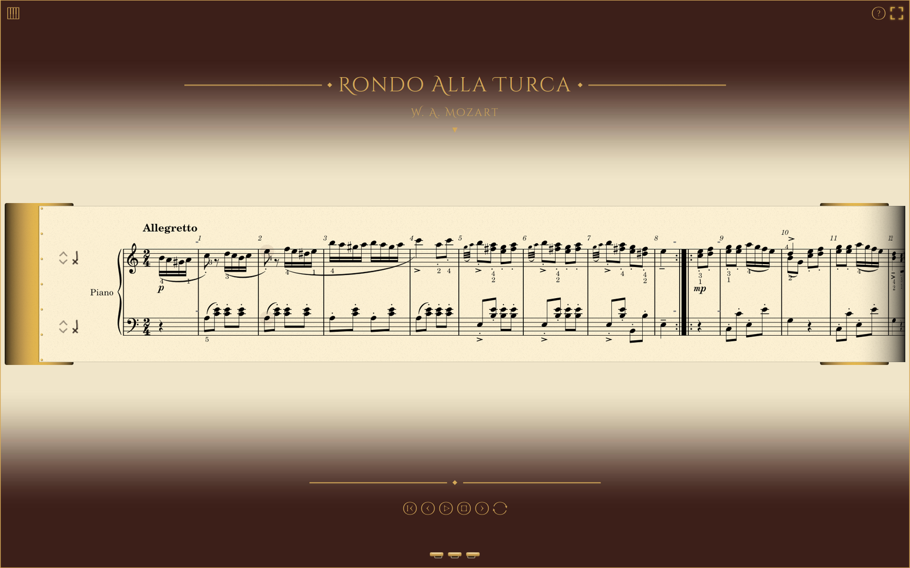

<p align="center">
  
</p>
<h1 align="center">Orchestrion</h1>
<p align="center"><em>What you don't play, Orchestrion plays for you.</em></p>



Plug your MIDI keyboard and play everything. Or just use your computer keyboard to play the rhythm.
Whatever you <em>don't play</em> - pitch, nuances, or even rhythm - Orchestrion plays for you.

One idea, many ways to play it: rhythm-focused practice in the music lesson, kids
getting familiar with notation while having fun, music lovers discovering
repertoire from the inside, covering that keyboard part your band can't do
without, or karaoke-like sing-song around the computer.

Built on [MuseScore](https://musescore.org)'s engraving and playback engine, wired to [Mutopia](https://www.mutopiaproject.org)'s score library.

**Website: <https://orchestrion.app/>**

## Download

Grab the [latest release](https://github.com/saintmatthieu/Orchestrion/releases/latest):

- **Windows** — `.msi` installer (available in English, French and German)
- **macOS** — signed & notarized `.dmg`
- **Linux** — AppImage: `chmod +x Orchestrion-*.AppImage && ./Orchestrion-*.AppImage`

## Building from source

Requirements: CMake 3.28 (3.31 on macOS), Ninja, Qt 6.10 or later (upstream MuseScore
states 6.8 but uses 6.10 API; with the `qtnetworkauth`, `qt5compat`, `qtscxml` and `qtshadertools` modules),
a C++20 compiler, Git LFS, and network access at configure time (MuseScore's
`muse_deps` downloads prebuilt third-party libraries).

```bash
git clone --recurse-submodules https://github.com/saintmatthieu/Orchestrion.git
cd Orchestrion
git lfs pull

cmake -B build -G Ninja \
  -DCMAKE_BUILD_TYPE=RelWithDebInfo \
  -DSMTG_ENABLE_VST3_PLUGIN_EXAMPLES=OFF \
  -DSMTG_ENABLE_VST3_HOSTING_EXAMPLES=OFF \
  -DSMTG_ENABLE_VSTGUI_SUPPORT=OFF

cmake --build build --target install
```

The executable lands in `build/install/bin/`. If CMake configuration fails with
confusing missing-target errors, the submodules are probably missing — run
`git submodule update --init --recursive`.

## License

[GPL-3.0](LICENSE) © 2024 Matthieu Hodgkinson.

Some bundled scores are community engravings — see
[`scores/attributions.json`](scores/attributions.json) for credits.
