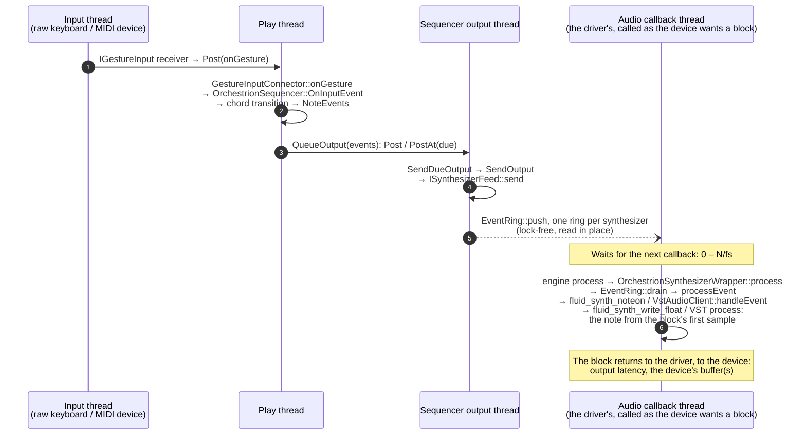

# From a gesture to its sound

What happens between a key struck (computer keyboard or MIDI device) and the
sound leaving the audio device (live playing, not offline rendering, where all
the sequencer's threads are the main thread). See also
`src/OrchestrionSequencer/threading.md`.

Each lane is a thread: an arrow from one lane to another is a hand-off (a
posted task, or data the other thread reads later), an arrow to the same lane
a synchronous call chain.

## Delays along the way

| Step | Delay | Kind |
| --- | --- | --- |
| 1–4 | Thread hops (posts) | well under 1 ms |
| 5 → 6 | Wait for the next block: 0 – N/fs | variable |
| 6 | The note starts at the block's first sample, whenever it came | (quantised to blocks) |
| after 6 | Device output latency, ≈ the buffer size and more | constant |

Until 2026-11-18 the output went through a kors channel, whose callbacks run
on the subscriber's thread: the synthesizers subscribed on the audio engine's
worker (`GeneralAudioWorker`, hybrid work mode), which processes its queue
every 16 ms. Every note waited 0–16 ms there, and a VST's event list was
filled on the worker while the audio thread read it, unlocked. Measured with
`--latency-trace` (`tools/latency_trace.py`; 1024 frames at 44.1 kHz), a
gesture's note-on reached its block in 25 ms (p50), 30 ms (p90), 37 ms (max)
then; 9, 19 and 26 ms with the rings.

After the block, the driver: on macOS, MuseScore's direct CoreAudio driver
(`CoreAudioDirect`, an IOProc on the device; Orchestrion's default since
2026-11-18, set in `OrchestrionSynthesisModule::onPreInit`) hands the block to
the device's IO buffer. The AudioQueue driver it replaced (`CoreAudio`, still
the fallback) kept a second block queued behind it: 23 ms more at 1024 frames
and 44.1 kHz, which the trace can't see. `DeviceFollowingAudioDriver` opens
the device at the rate it already runs at (the direct driver would set the
device to the asked rate, for the whole system), stays on the system's default
device as it changes, and has the device reopened when someone else changes
its rate (what the system tells of devices: `OutputDevice.h`, macOS only so
far).

What is left is the wait for the next block, which a smaller buffer shortens.
Timestamps would let each note start at its own sample offset in the block: a
constant latency of about one block in place of that jitter.
